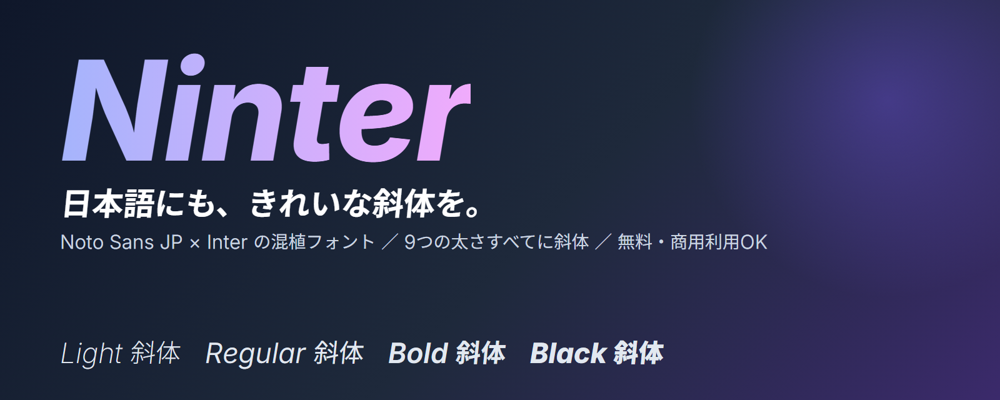
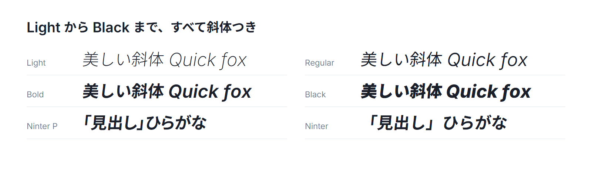

<p align="center"></p>

# Ninter

**日本語にも、きれいな斜体を。**

Ninter は、和文フォントの Noto Sans JP と、欧文フォントの Inter を組み合わせた混植フォントです。日本語を斜体にしても不格好にならず、英数字もすっきり読みやすく表示されます。無料で使えて、商用利用もできます。

---

## Ninter の魅力

### 1. 日本語の斜体が自然に見える

PowerPoint や Word で日本語に斜体（Ctrl+I）をかけると、多くのフォントでは文字が大きく傾いた、いかにも機械的な斜体になります。

Ninter には本物の斜体フォントが用意されています。日本語は約5.5度だけ控えめに傾けるので、読みやすさを保ったまま、強調したい部分にさりげなく動きを出せます。欧文は Inter 本来の斜体になります。


### 2. 英数字が美しい

アルファベット、数字、記号には、画面での読みやすさに定評のある Inter を使っています。日本語の中に英単語や数字が混ざっても、文字の大きさや高さがそろい、違和感が出にくくなっています。

- 時刻や比率（12:34）のコロンは、数字の中央の高さにそろいます
- ①②のような丸数字や、囲み記号は、日本語フォント側の全角の字形になります
- 日本語と英数字が同じ行にあっても、Inter の合字や数字の切り替え機能が使えます

### 3. 9つの太さ、すべてに斜体つき

Thin から Black まで 9段階の太さがあり、それぞれに斜体があります。

| 太さ | Thin / ExtraLight / Light / Regular / Medium / SemiBold / Bold / ExtraBold / Black |
|---|---|
| 斜体 | すべての太さに対応 |



Ctrl+B で太字、Ctrl+I で斜体という、いつもの操作がそのまま使えます。

### 4. 字詰めありと、なしを選べる

MS ゴシックと MS P ゴシックの関係と同じように、2つのファミリーがあります。

| ファミリー | 字間 | 向いている使い方 |
|---|---|---|
| **Ninter** | すべて全角でそろう | 本文、表、きっちり並べたい文章 |
| **Ninter P** | かなや括弧が詰まる | 見出し、タイトル、スライドの大きな文字 |

どちらも 9つの太さと斜体を持っているので、全部で 36種類のフォントになります。

---

## インストール方法（Windows）

完成済みのフォントがこのリポジトリの `build` フォルダに入っているので、ビルドは不要です。管理者権限も必要ありません。

### ZIP ファイルからインストールする

Git を使わない方は、この方法が簡単です。ダウンロードは全部で 100MB を超えるので、少し時間がかかります。

1. GitHub のリポジトリページで、緑色の「Code」ボタンを押し、「Download ZIP」を選びます。
2. ダウンロードした ZIP ファイルを右クリックして「すべて展開」を選び、わかりやすい場所（デスクトップなど）に展開します。
3. 展開したフォルダを開き、中の `scripts` フォルダが見える状態にします。
4. フォルダ内の何もない場所で右クリックし、「ターミナルで開く」を選びます。
5. 次のコマンドを貼り付けて Enter キーを押します。

```powershell
powershell -ExecutionPolicy Bypass -File scripts/install.ps1
```

6. 「Ninter: 36 updated」のような表示が出たら完了です。開いている Word や PowerPoint があれば、いったん終了して開き直します。
7. フォントの一覧から **Ninter** または **Ninter P** を選びます。

インストール後は、展開したフォルダを削除しても大丈夫です。

### Git を使う場合

```bash
git clone https://github.com/ykuwai/ninter.git
cd ninter
powershell -ExecutionPolicy Bypass -File scripts/install.ps1
```

### アンインストール

```powershell
powershell -ExecutionPolicy Bypass -File scripts/install.ps1 -Uninstall
```

### 手動でインストールしたい場合

`build` フォルダにある `.ttf` ファイルをすべて選び、右クリックして「ユーザーのみインストール」を選んでも使えます。Ctrl+I や Ctrl+B を正しく連動させるため、同じファミリーのファイルはまとめてインストールしてください。

---

## インストール方法（Mac）

Windows と同じく、ZIP をダウンロードして展開すれば、ビルドなしで使えます。

### Font Book でインストールする

1. ZIP を展開して、中の `build` フォルダを開きます。
2. `Ninter` で始まる `.ttf` ファイルをすべて選択します。`NinterP` で始まるファイルも使いたい場合は、あわせて選びます。
3. 選んだファイルをダブルクリックすると Font Book が開くので、「フォントをインストール」を押します。
4. 確認の画面が出たら、そのまま進めます。
5. Word や PowerPoint を終了して開き直し、**Ninter** または **Ninter P** を選びます。

### ターミナルでインストールする

展開したフォルダで次のコマンドを実行すると、ユーザー単位でまとめてインストールできます。

```bash
cp build/*.ttf ~/Library/Fonts/
```

アンインストールするときは、`~/Library/Fonts` から `Ninter` で始まるファイルを削除します。

Mac では、斜体は **Command+I**、太字は **Command+B** です。なお、動作確認は Windows の Word と PowerPoint で行っています。Mac での見え方は、確認できしだいここに追記します。

---

## 使い方

1. 文字を選択して、フォント名に **Ninter**（または **Ninter P**）を指定します。
2. 強調したい部分を選んで **Ctrl+I**（Mac では Command+I）を押すと、日本語も欧文も自然な斜体になります。
3. 太字にしたいときは **Ctrl+B**（Mac では Command+B）を押します。
4. Regular と Bold 以外の太さは、フォント一覧の「Ninter Light」「Ninter P SemiBold」などから選べます。

---

## よくある質問

**日本語の斜体の傾きは変えられますか。**
変えられます。ビルドの設定で傾きの角度を調整できます。詳しくは [ビルドガイド](docs/BUILDING.md) を見てください。

**Ctrl+I を押しても斜体にならないのですが。**
フォントをインストールしたあとに、Word や PowerPoint を開き直していないことが多いです。いったんアプリを終了して、もう一度開いてください。

**縦書きは使えますか。**
現在は横書きだけに対応しています。

**自分でフォントを作り直したり、設定を変えたりしたいです。**
[ビルドガイド](docs/BUILDING.md) に、手順と設定項目、仕組みをまとめています。

---

## ライセンス

元になっている Noto Sans JP（© Google）と Inter（© The Inter Project Authors）は、どちらも SIL Open Font License 1.1 で公開されています。Ninter もその派生物として、同じ SIL Open Font License 1.1 に従います。個人でも商用でも自由に使えます。詳しい条件は `LICENSE` を見てください。
